## 👋 About me

I'm **Kaushal**, a **freelance web developer** from India. I turn real business problems into fast, simple software that people actually use.

- 🏨 Built a **hotel management system** for a real client, **Hotel Lucky**: bookings, front desk, GST billing
- 🤖 Built **[HireSense](https://github.com/kaushal-o4/hiresense)**, an AI-powered interview & placement platform with live voice interviews
- 🎯 I care about clean UI, correct business logic and code that is **tested**
- 💼 **Open to** freelance projects, internships and full-time developer roles
- 📫 Reach me at **[kaushalsurya9199@gmail.com](mailto:kaushalsurya9199@gmail.com?subject=Project%20%2F%20Job%20opportunity%20for%20Kaushal)**

## 🚀 Featured projects

<table>
<tr>
<td width="50%" valign="top">

### 🏨 [Hotel Management System](https://github.com/kaushal-o4/hotel-management-system)
Freelance project · Hotel Lucky

Visual **tape-chart** reservations, live front-desk room board, **GST invoices** (CGST/SGST), occupancy, ADR & RevPAR dashboard, role-based staff login.

`JavaScript` `HTML` `CSS` `Web Crypto` `GitHub Actions`

[**▶ Live demo**](https://kaushal-o4.github.io/hotel-management-system/) · [Code](https://github.com/kaushal-o4/hotel-management-system)

</td>
<td width="50%" valign="top">

### 📄 [ResumeFit](https://github.com/kaushal-o4/resumefit)
Open source · ATS resume checker

Paste a resume and a job description. Get an **ATS match score**, missing skills, keyword gaps and fixes. Runs **100% in the browser**: private by design.

`JavaScript` `pdf.js` `Node test runner` `GitHub Pages`

[**▶ Live demo**](https://kaushal-o4.github.io/resumefit/?demo) · [Code](https://github.com/kaushal-o4/resumefit)

</td>
</tr>
<tr>
<td colspan="2">

### 🤖 [HireSense: AI Interview & Placement Platform](https://github.com/kaushal-o4/hiresense)
Team project · 5 members

An end-to-end placement platform with **Student, Recruiter, Admin and Mentor** portals. Students take **live voice interviews with 3D AI interviewers** that listen, transcribe and score answers in real time, plus resume analysis, job matching, English practice with spaced vocabulary review, and progress reports. Recruiters compare candidates side by side and export reports. **369 backend + 141 frontend tests** run in CI on every push.

`React` `Tailwind` `FastAPI` `Python` `MongoDB` `LLMs (Gemini / Ollama)` `Whisper` `three.js` `MediaPipe`

[**Code & screenshots**](https://github.com/kaushal-o4/hiresense)

</td>
</tr>
</table>

## 🛠️ Tech stack

## 💼 What I can build for you

| | |
|---|---|
| 🏢 **Business software** | Booking, billing, inventory, CRM and admin dashboards tailored to your workflow |
| 🌐 **Websites & web apps** | Fast, responsive sites and single-page apps that work on every device |
| 🤖 **AI features** | Chatbots, resume/document analysis, voice and LLM-powered tools |
| 🧾 **Indian business needs** | GST invoices, UPI/cash/card payment tracking, printable reports |

### 📬 Have a project or a job opening?

## 🐍 Contribution activity

<picture>
  <source media="(prefers-color-scheme: dark)" srcset="https://raw.githubusercontent.com/kaushal-o4/kaushal-o4/output/github-snake-dark.svg" />
  
</picture>

⭐ If you like my work, star a repo. It really helps!

